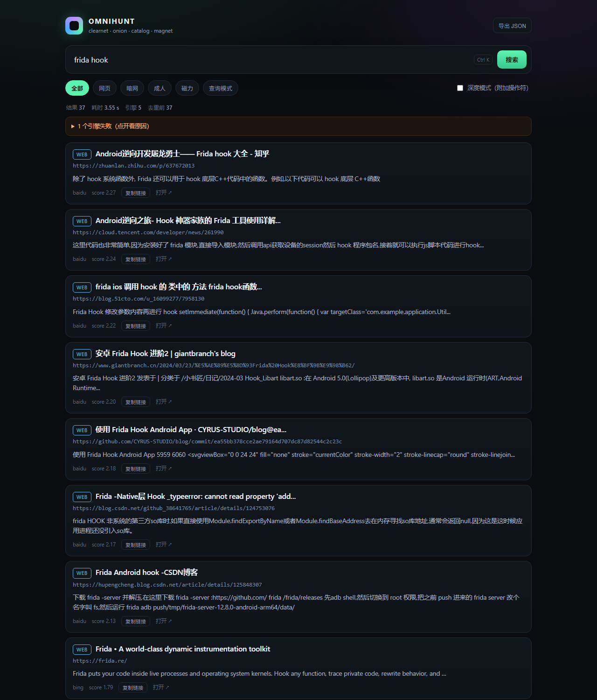
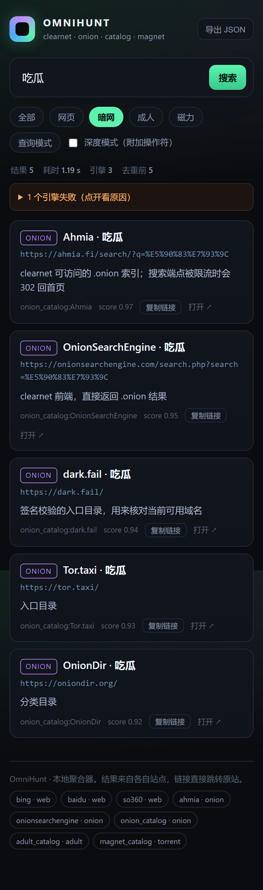

# OmniHunt · 万能聚合搜索引擎

一个本地跑的多源搜索聚合器：**一次查询**同时打 clearnet 搜索引擎、`.onion` 暗网索引、成人站目录、磁力/DHT 索引，结果按 URL 去重、统一打分排序，CLI 和 Web UI 共用同一套后端。

```
查询 "关键词"
   ├─ duckduckgo / bing / baidu / mojeek / searx   → 网页
   ├─ ahmia / onionsearchengine（实时）+ onion 目录 → 暗网
   ├─ adult_sites.json (24 站)                    → 成人站内搜索直链
   ├─ magnet_sources.json (10 站) + nyaa 适配器     → 磁力 / infohash
   └─ 查询模式生成器（site:/intitle:/urn:btih）      → 操作符
        ↓
   规范化 URL → 去重 → 打分 → 混合排序（直链有配额，避免刷屏）
```



## 1. 快速开始

```powershell
cd E:\deepseeek\omnihunt
pip install -r requirements.txt

# 命令行
python -m omnihunt search "关键词"
python -m omnihunt search "关键词" --kinds onion --limit 20
python -m omnihunt search "关键词" --patterns --json out.json --md out.md

# Web UI
python -m omnihunt serve --port 7860
# 打开 http://127.0.0.1:7860

# 离线回放（不联网，用 fixtures 验证解析与排序）
python -m omnihunt search "demo" --offline --patterns
```

PowerShell 快捷封装：

```powershell
.\run.ps1 "关键词" -Kinds web,onion,adult,torrent -Limit 40
.\run.ps1 -Serve -Port 7860
.\run.ps1 "关键词" -Offline
```

环境变量（覆盖 yaml）：

| 变量 | 作用 |
|---|---|
| `OMNI_TOR_SOCKS` | Tor SOCKS5，默认 `127.0.0.1:9050` |
| `OMNI_HTTP_PROXY` | 可选 HTTP 代理，例如 `http://127.0.0.1:7890` |
| `OMNI_TIMEOUT` | 单请求超时秒数 |
| `NO_COLOR=1` | 关闭 CLI 颜色 |

## 2. 目录结构

```
omnihunt/
├─ omnihunt/
│  ├─ engine.py        # 调度：线程池扇出 → 缓存 → 合并 → 排序
│  ├─ net.py           # requests + Tor SOCKS5 + 限速 + 重试 + 离线 fixture
│  ├─ models.py        # Result / SearchResponse / URL 规范化（去重键）
│  ├─ rank.py          # 去重合并 + 打分
│  ├─ patterns.py      # 查询操作符表（数据驱动）
│  ├─ cache.py         # SQLite 结果缓存（per-engine, TTL）
│  ├─ cli.py           # search / serve / engines / catalog / patterns / cache
│  ├─ web.py           # stdlib HTTP 服务 + /api/* + PWA 路由
│  ├─ assets/index.html# 单页 UI（含 PWA 元信息）
│  ├─ assets/manifest.webmanifest
│  ├─ assets/sw.js     # 外壳缓存 Service Worker
│  ├─ assets/icons/    # 192 / 512 / 180 PNG
│  └─ adapters/
│     ├─ clearnet.py   # duckduckgo / ddg_lite / bing / baidu / so360 / mojeek / searx
│     ├─ onion.py      # ahmia / onionsearchengine / onion_index
│     ├─ regex.py      # 通用正则适配器：任意站点零代码接入
│     ├─ catalog.py    # JSON 目录 → 站内搜索直链
│     └─ torrent.py    # nyaa / magnet 页面收割
├─ config/engines.yaml # 引擎开关与参数
├─ catalog/            # adult_sites / onion_index / magnet_sources
├─ fixtures/pages/     # 离线回放页面
├─ ios/                # SwiftUI 客户端 + project.yml（XcodeGen）
├─ tools/make_icons.py # 重新生成 PWA / AppIcon
└─ data/cache.sqlite   # 运行时生成
```

## 3. 引擎配置

`config/engines.yaml` 每个条目就是一个适配器实例：

```yaml
- name: my_engine      # 唯一名，--engines 用它过滤
  type: regex          # 适配器类型
  kind: onion          # web | onion | adult | torrent
  weight: 0.9          # 排序权重
  base: http://HOST
  path: /search?q={q}
  via: tor             # tor = 走 SOCKS5；clearnet = 直连
  enabled: true
```

| type | 说明 | 关键字段 |
|---|---|---|
| `duckduckgo` | html 端点解析（默认关闭：部分网络不可达） | — |
| `ddg_lite` | 轻量端点，DDG 限流时启用 | — |
| `bing` | `li.b_algo` 解析，自动解 `/ck/a` 跳转；`ensearch=1` 避免本地化 | — |
| `baidu` | 移动端点优先、桌面端点兜底，从 `data-log` 里取真实 URL | — |
| `so360` | 360 搜索，读 `data-mdurl` 拿真实 URL；百度验证码时的兜底 | — |
| `mojeek` | 独立索引（默认关闭：无 JS 会返回挑战页） | — |
| `searx` | 自建 SearXNG，需开 `format=json` | `base` |
| `ahmia` | `.onion` 索引（clearnet 可达） | `base`, `path` |
| `onionsearchengine` | clearnet 前端，直接返回 .onion 结果 | `base`, `path` |
| `onion_index` | 任意 onion 索引，CSS 选择器配置 | `item/link/title/snippet` |
| `regex` | 没有稳定 DOM 时用正则切块 | `item/link/title/snippet` |
| `catalog` | JSON 站点目录 → 直链 | `catalog`, `max_sites` |
| `nyaa` | nyaa/sukebei 表格解析，直接拿 magnet | `base` |
| `magnet` | 通用 magnet 收割（按 btih 去重） | `item`, `title` |

默认启用 `bing` + `baidu` + `so360` + `ahmia` + `onionsearchengine` + 三个目录（成人 / 磁力 / onion）。DuckDuckGo / Mojeek 在现代住宅网络之外经常被墙或被 JS 挑战，所以默认关闭，换网络或自建 SearXNG 后把 `enabled` 改回 `true` 即可。

Ahmia 的 `/search/` 在限流或维护时会 302 回首页；适配器会把这种情况报成引擎错误（而不是"0 条结果"），一眼能看出是站点侧问题。

新增站点 = 加一段 yaml，**不用改代码**。

## 4. 暗网部分

暗网层是 **实时索引 + 目录兜底** 两段式，「暗网」筛选不会因为单个索引站挂掉而空着：

| 引擎 | 角色 |
|---|---|
| `onionsearchengine` | clearnet 前端，解析 `li.result-item`，直接给 `.onion` 链接（实测可用） |
| `ahmia` | clearnet 可达的 `.onion` 索引；端点被限流时如实报错 |
| `onion_catalog` | 目录链接：Ahmia / OnionSearchEngine 搜索页 + dark.fail / tor.taxi / oniondir 入口，任何关键词都有返回 |

注意：主流 onion 索引对中文关键词覆盖很差（`吃瓜` 这类词通常 0 条），英文关键词命中率高得多；目录链接始终可用，用来拿当前入口。

`.onion` 必须经 Tor：

1. 起 Tor（Tor Browser 自带，或 `tor.exe`），确认 `9050` 在听；
2. 默认 `http.tor_socks: 127.0.0.1:9050`，无需改代码，`:x.onion` 自动走代理；
3. `--tor-all` 让 clearnet 也走 Tor（统一出口，避免本地 IP 泄露）。

```powershell
python -m omnihunt search "关键词" --kinds onion --tor-all
```

Ahmia 是 clearnet 可达的 `.onion` 索引，默认开启。其他索引站地址会轮换，`catalog/onion_index.json` 里用 `TORCH_ONION` / `ONIONLAND_ONION` 这类占位符，先从 `dark.fail`、`tor.taxi` 核对当前可用域名再替换；`enabled: false` 的条目不参与搜索。

新增暗网索引两种方式：

```yaml
# A. CSS 选择器
- name: my_onion_index
  type: onion_index
  kind: onion
  base: http://REPLACE_ME.onion
  path: /search?q={q}
  via: tor
  item: 'li.result'
  link: 'h4 a'
  snippet: 'p'

# B. 正则切块（结构不稳定时）
- name: my_onion_regex
  type: regex
  kind: onion
  base: http://REPLACE_ME.onion
  path: /search?q={q}
  via: tor
  item: '<li class="hit">'
  link: '<a[^>]+href="([^"]+)"'
  title: '<a[^>]*>(.*?)</a>'
```

## 5. 成人目录

`catalog/adult_sites.json` 是纯数据：站点名 + 站内搜索模板，`{q}` 自动 URL 编码。

```json
{"name": "MissAV", "search": "https://missav.com/search/{q}", "kind": "adult", "tags": ["jav"], "region": "jp"}
```

覆盖 tube / JAV 目录 / 同人志 / booru 图库 / 社区 / 游戏论坛共 24 站。目录适配器**不发请求**，只生成"带关键词的站内搜索链接"，因此 JS 站、需登录站、Cloudflare 站照样能用。

需要真正抓取某站结果时，给它写 `onion_index` 或 `regex` 配置（把 `via` 设 `clearnet`），或直接给该站写 10 行适配器（见第 9 节）。

## 6. 磁力 / DHT

- `magnet_catalog`：BT4G、BTDig、Nyaa、Sukebei、1337x、LimeTorrents、TorrentGalaxy、SolidTorrents、Knaben、Internet Archive —— 生成带关键词的索引页链接。
- `nyaa` 适配器（默认关闭）：直接解析表格，抽出 `magnet:?xt=urn:btih:...`，UI 里出现「复制磁力」按钮；按 infohash 去重。

```powershell
python -m omnihunt search "关键词" --engines nyaa,magnet_catalog --kinds torrent
```

magnet 参数参考：`dn` 显示名、`tr` tracker、`xl` 长度。同一 infohash 在不同索引站是同一资源，聚合器按 `btih` 去重。

## 7. 查询模式

`python -m omnihunt patterns "关键词"` 输出可直接复制的操作符；`--patterns` 把它们作为 `pattern` 类型结果并入排序（默认排在自然结果之后）。

| 类别 | 示例 |
|---|---|
| 精确 | `"关键词"` |
| 标题 | `intitle:"关键词"` |
| 路径 | `inurl:tag` |
| 目录 | `intitle:"index of" "关键词"` |
| 文件 | `关键词 filetype:mp4 OR filetype:mkv` |
| 归档 | `关键词 (filetype:zip OR filetype:rar)` |
| 暗网 | `关键词 site:onion`（Ahmia）、`关键词 onion mirror` |
| 磁力 | `关键词 magnet`、`"关键词" "urn:btih"` |
| 成人 | `关键词 inurl:tag`、`site:pornhub.com "关键词"` |

## 8. 排序与去重

去重键 = `scheme + host + path + 白名单排序后的 query`，剥离 `utm_*` / `fbclid` / `gclid` 等跟踪参数，并解开 DDG/Bing 的跳转包装。同一键的多个来源合并成一条，`sources` 记录全部命中引擎。

```
score = weight × (0.55 + 0.45 × 位置衰减)
      + 1.05 × 标题命中率 + 0.35 × 摘要命中率
      + 类型加成 + 0.10 × (额外来源数)
```

- 直链（catalog）与 pattern 的标题本身含查询词，属"自证"，词法加成压到 0.30；
- 直链最多占结果数的 55%，防止几十条"站内搜索链接"挤掉真实页面；
- 同分时按 `kind`（onion → web → adult → torrent）再按标题稳定排序。

要改排序口味：`rank.py` 顶部四个常量即可。

## 9. 扩展：30 行写一个适配器

```python
# omnihunt/adapters/mysite.py
from bs4 import BeautifulSoup
from .base import Adapter

class MySiteAdapter(Adapter):
    kind = "web"
    weight = 0.9

    def search(self, query, limit):
        url = self._search_url(query)                  # base + path（{q} 已编码）
        soup = BeautifulSoup(self.client.get(url, tag=self.name), "lxml")
        out = []
        for li in soup.select("div.item"):
            a = li.select_one("a")
            if not a:
                continue
            out.append(self._result(a.get_text(" ", strip=True), a["href"], li.get_text(" ")))
            if len(out) >= limit:
                break
        return out
```

在 `adapters/__init__.py` 的 `ADAPTER_TYPES` 注册 `"mysite": MySiteAdapter`，再在 yaml 里 `type: mysite` 即可。适配器只需返回 `Result` 列表；限速、重试、缓存、去重、排序都由内核处理。

## 10. HTTP API

```bash
curl "http://127.0.0.1:7860/api/search?q=demo&kinds=onion,web&limit=20&per_engine=10&patterns=1"
curl "http://127.0.0.1:7860/api/engines"
curl "http://127.0.0.1:7860/health"
curl -I "http://127.0.0.1:7860/manifest.webmanifest"
curl -I "http://127.0.0.1:7860/sw.js"       # 带 Service-Worker-Allowed: /
```

响应字段：

```json
{
  "query": "demo",
  "took_ms": 812,
  "cached": false,
  "count": 20,
  "stats": {"engines": [{"name": "ahmia", "kind": "onion", "count": 8, "ms": 640, "cached": false}],
            "raw": 47, "unique": 20, "cached_engines": 0},
  "errors": [{"engine": "bing", "message": "HTTP 503 ..."}],
  "results": [{"title": "...", "url": "...", "snippet": "...", "source": "ahmia",
               "kind": "onion", "score": 1.83, "sources": ["ahmia"], "extra": {}}]
}
```

单引擎失败只进 `errors`，不影响整体返回。

## 11. 运维要点

- **缓存**：`data/cache.sqlite`，per-engine TTL 默认 1800s；`--no-cache` 绕过，`python -m omnihunt cache purge` 清理过期。
- **限速**：`http.rate_per_sec` 按 host 计，默认 1.5 req/s；聚合器不会并发轰炸同一站点。
- **超时**：`search.timeout` 是整轮墙钟；内核把每次 socket 超时压到 `timeout/(retries+1)`，死网络下也按时收口。
- **Tor 不通**：错误里会出现 `SOCKS` / `ProxyError`；先 `curl --socks5-hostname 127.0.0.1:9050 https://check.torproject.org` 验证。
- **被反爬**：换 `ddg_lite`、加自建 `searx`、或提高 `rate_per_sec` 的间隔。

## 12. iOS / 移动端

两条路，按有没有 Mac 选：

**A. PWA（不用 Mac，现在就能用）**

```powershell
python -m omnihunt serve --host 0.0.0.0 --port 7860
```

手机 Safari 打开 `http://<电脑IP>:7860` → 分享 → **添加到主屏幕**。得到独立图标、全屏无地址栏、`apple-mobile-web-app` 元信息、安全区内边距；`sw.js` 只缓存外壳，`/api/*` 始终走网络，不会给你过期结果（Service Worker 需要 https 或 localhost，局域网 http 下自动跳过，不影响安装）。

**B. 原生 SwiftUI（需要 macOS + Xcode 15+）**

源码在 `ios/`，用 XcodeGen 生成工程：

```bash
brew install xcodegen
cd ios && xcodegen generate
open OmniHunt.xcodeproj
```

- 搜索栏 / 类型筛选（全部·网页·暗网·成人·磁力·模式）/ 深度模式开关 / 结果卡片（复制链接、复制磁力、打开、系统分享）
- 设置页填服务器地址 + 「测试连接」（打 `/health`，显示 `已连接 · 8 个引擎`）
- 请求 35s 超时、取消上一个 Task、引擎失败折叠面板；`Info.plist` 已配 ATS 局域网例外与本地网络权限说明
- 细节与排错见 [`ios/README.md`](ios/README.md)

手机连不上通常是三件事：后端没加 `--host 0.0.0.0`、Windows 防火墙没放行 7860、手机在访客网络/AP 隔离。



图标由 `python tools/make_icons.py` 生成（PWA 三档 + iOS 1024），改配色只改这一个脚本。

## 13. 边界

- 本工具只做**索引聚合与跳转**，不代理、不托管、不缓存任何第三方内容；正文与文件始终在原站。
- 各站点可用性、内容合法性、访问权限因地区与站点政策而异，出现 403/451/超时属正常现象，会记录在 `errors` 里。
- 需要登录/付费/邀请的站点只生成搜索链接，不绕过任何访问控制。
